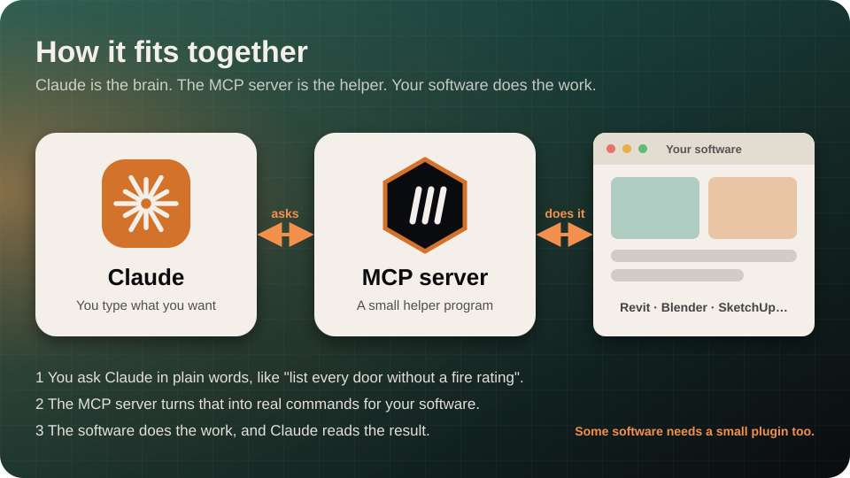
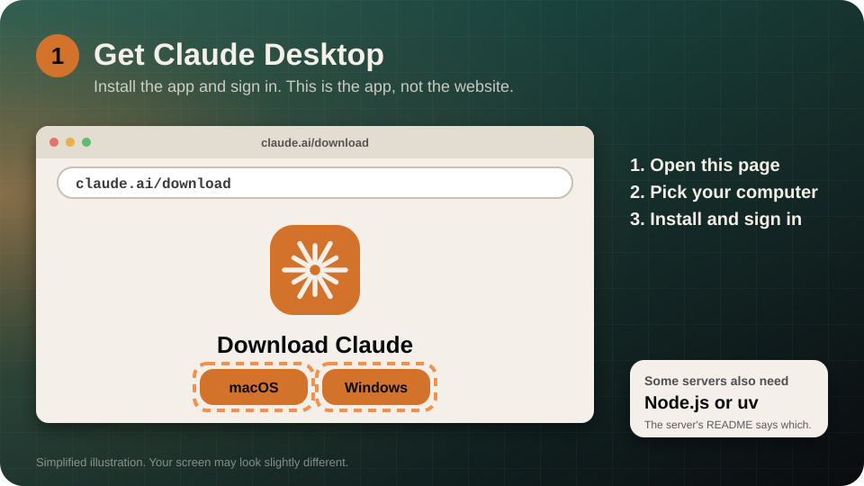
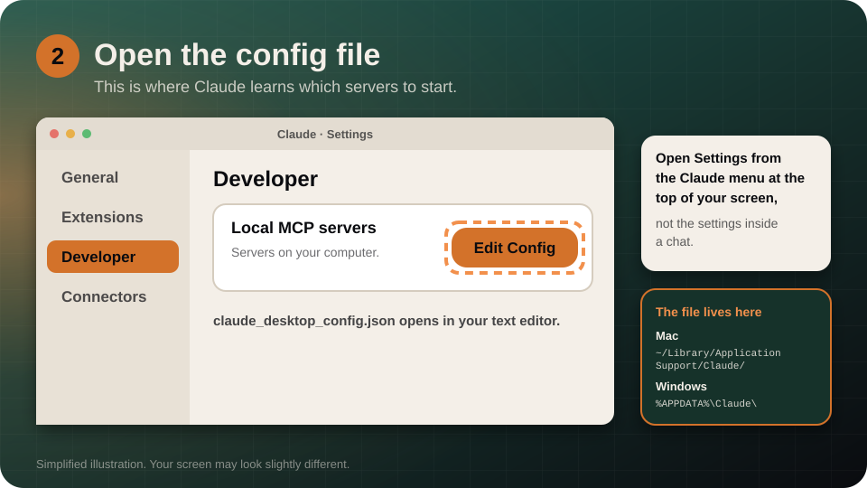
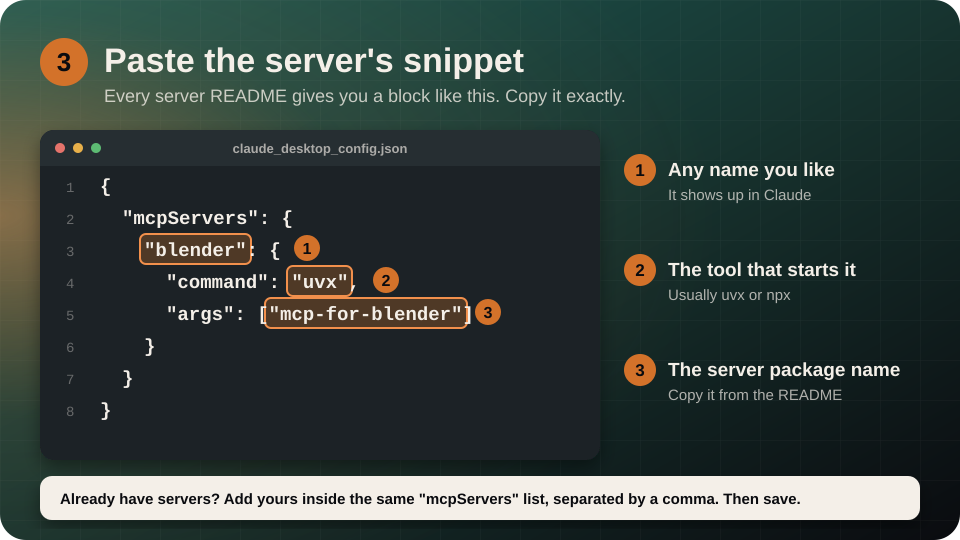
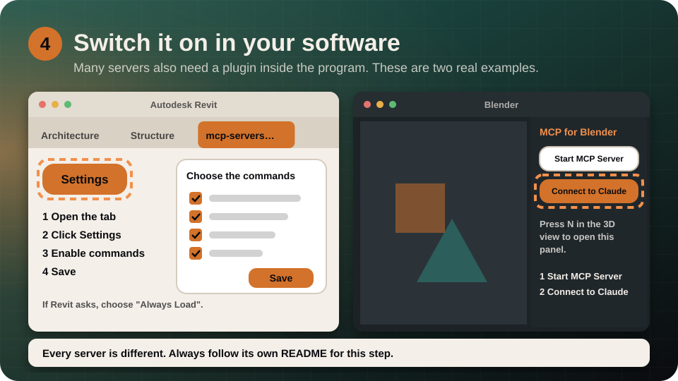
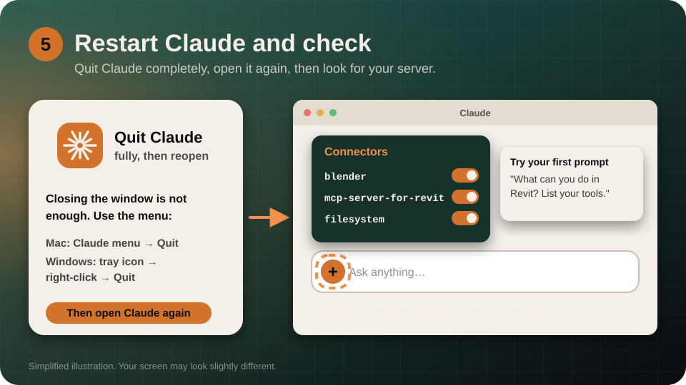
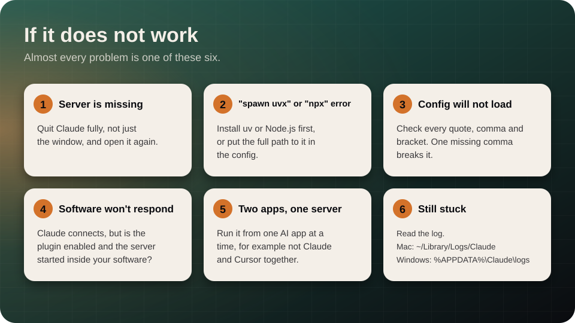

# Setup guide for beginners

How to connect an MCP server to Claude, step by step. No coding needed. It takes about 10 minutes, and the steps are the same for Revit, Blender, SketchUp, Rhino, AutoCAD and the rest.

> Checked against the official Claude and MCP documentation on 2026-10-31. The pictures are simplified drawings, so your screen may look slightly different. Menus change from time to time, so if something has moved, follow the links in [Official docs](#official-docs).

[← Back to the directory](README.md) · [Prefer a web page? Open the guide on the site](https://ahmakader.github.io/arch-mcp-atlas/guide.html)

---

## What you need

| You need | Where to get it |
| :-- | :-- |
| **Claude Desktop** (the app) | [claude.ai/download](https://claude.ai/download), for Mac and Windows. Sign in with your Claude account. |
| **Node.js** or **uv** | Only if the server's README says so. Node.js: [nodejs.org](https://nodejs.org/) (choose the LTS version). uv: [install instructions](https://docs.astral.sh/uv/getting-started/installation/). |
| **Your software** | Revit, Blender, SketchUp… Some servers also need a small plugin inside it. The server's README explains it. |
| **A server to connect** | Pick one from the [directory](README.md). |

## The big picture



**Claude** is the brain. The **MCP server** is a small helper program that lets Claude press buttons in your software. Your **software** does the work. You only talk to Claude in plain words.

## Pick your way in


Open the server's README and look at its install section. It will match one of these.

| | You have | Do this |
| :-- | :-- | :-- |
| **A** | A `.mcpb` file | **Settings → Extensions**, drag the file in, click **Install**. |
| **B** | A web address (URL) | **Customize → Connectors → Add custom connector**, paste the URL, click **Add**, then **Connect**. |
| **C** | A snippet of JSON and a command like `uvx` or `npx` | Follow the five steps below. **This is what most architecture servers use.** |

Not sure? Use **C**.

---

## Way C: the config file (five steps)

### 1. Install Claude Desktop



Go to [claude.ai/download](https://claude.ai/download), choose your computer, install it, and sign in. If the server's README asks for Node.js or uv, install that now too.

### 2. Open the config file



1. In the **Claude menu at the top of your screen** (not the settings inside a chat), choose **Settings…**
2. Click **Developer** in the left list.
3. Click **Edit Config**. A file called `claude_desktop_config.json` opens.

The file lives here if you need to find it yourself:

- **Mac:** `~/Library/Application Support/Claude/claude_desktop_config.json`
- **Windows:** `%APPDATA%\Claude\claude_desktop_config.json`

### 3. Paste the server's snippet



Copy the snippet from the server's README and paste it into the file. For example, this is the real snippet for the Blender server:

```json
{
  "mcpServers": {
    "blender": {
      "command": "uvx",
      "args": ["mcp-for-blender"]
    }
  }
}
```

1. **`"blender"`** is just a name you choose. It is what you will see in Claude.
2. **`"uvx"`** is the tool that starts the server. It is usually `uvx` or `npx`.
3. **`"mcp-for-blender"`** is the server's package name. Always copy it from the README.

If the file already lists other servers, add yours inside the same `"mcpServers"` section with a comma between them. Then **save the file**.

### 4. Switch it on inside your software



Many servers need a plugin installed in the program itself. Every server does this differently, so follow its README. See the two worked examples below.

### 5. Restart Claude and check



1. **Quit Claude completely.** Closing the window is not enough. On Mac use the Claude menu → **Quit**. On Windows right-click the tray icon → **Quit**.
2. Open Claude again.
3. In the chat box, click the **+** (the "Add files, connectors, and more" button), then **Connectors**. Your server should be in the list.
4. Try a first prompt: *"What can you do in Revit? List your tools."*

---

## Way A: a one-click extension (.mcpb file)

1. In Claude Desktop, open **Settings → Extensions**.
2. Drag the `.mcpb` file onto the page.
3. Check the preview, click **Install**, then confirm.

The extension runs on your own computer, and it includes what it needs, so there is no config file to edit. Your organization can turn extensions off, in which case **Extensions** won't appear in Settings.

## Way B: a web address (remote server)

1. In Claude, go to **Customize → Connectors**.
2. Click **Add custom connector**.
3. Paste the server's URL, for example `https://example.com/mcp`.
4. Click **Add**, then **Connect** and sign in if it asks.
5. In a chat, click **+ → Connectors** to switch it on or off for that conversation.

On a Free plan you can add one custom connector. On Team and Enterprise plans an organization Owner adds it first, and members then connect. If your screen differs, see Anthropic's page on [adding a connector that isn't in the directory](https://claude.com/docs/connectors/custom).

## Using Claude Code instead

If you use Claude Code in a terminal, one command does the whole job:

```bash
claude mcp add my-server -- npx -y package-name
```

The `--` separates Claude's options from the server's own command. For a server with a web address:

```bash
claude mcp add --transport http my-server https://example.com/mcp
```

Then type `/mcp` inside Claude Code to see the status. `claude mcp list` shows all servers, and `claude mcp remove my-server` removes one.

---

## Two real examples

### Example 1: Blender ([mcp-for-blender](https://github.com/ahujasid/blender-mcp))

Needs Blender 3.0 or newer. Source: the project's README.

1. **Install uv.** Mac: `brew install uv`. Windows: `winget install --id=astral-sh.uv -e`. Do **not** use `pip install uv`.
2. **Add the server to Claude** with the snippet in step 3 above.
3. **Install the Blender add-on.** In a terminal run `uvx mcp-for-blender install-addon`. In Blender open **Edit → Preferences → Add-ons**, search for "MCP for Blender" and enable **Interface: MCP for Blender**.
4. **Connect.** In the 3D view press **N**, open the **MCP for Blender** tab, click **Start MCP Server** if needed, then click **Connect to Claude**.
5. **Quit Claude fully and reopen it.**

### Example 2: Revit ([mcp-servers-for-revit](https://github.com/mcp-servers-for-revit/mcp-servers-for-revit))

Windows, Revit 2020 to 2026, plus Node.js. Source: the project's README.

1. **Install the plugin.** Download the ZIP for your Revit version from the project's Releases page, extract it, and copy the contents to `%AppData%\Autodesk\Revit\Addins\<your Revit version>\`.
2. **Add the server to Claude** (**Settings → Developer → Edit Config**):

   ```json
   {
     "mcpServers": {
       "mcp-server-for-revit": {
         "command": "cmd",
         "args": ["/c", "npx", "-y", "mcp-server-for-revit"]
       }
     }
   }
   ```

3. **Start Revit.** If it asks about an unknown add-in, click **Always Load**.
4. Open the **mcp-servers-for-revit** ribbon tab, click **Settings**, turn on the commands you want, and click **Save**.
5. **Quit Claude fully and reopen it.**

---

## Try these first prompts

Start with questions that only **read** your model:

- "What tools do you have from this server?"
- "List the levels in my model."
- "Describe what I am looking at in the current view."
- "Which doors have no fire rating?"

Move on to edits once you trust the setup.

> [!CAUTION]
> An MCP server can change your model, run scripts and read your files. Always work on a **copy** of the project, check what Claude plans to do before you approve it, and only install servers whose source you trust. Claude asks for your approval before using a tool, so read each request.

## If it does not work



| Problem | Fix |
| :-- | :-- |
| The server is missing in Claude | Quit Claude fully (not just the window) and open it again. |
| `spawn uvx ENOENT` or an `npx` error | Install uv or Node.js first. If it is installed, put the full path in the config: run `which uvx` on Mac or `where uvx` on Windows and use that in `"command"`. |
| Claude says the config is invalid | Check the JSON: every quote, comma and bracket must match. |
| Claude connects but the software does nothing | Is the plugin installed, enabled and started inside your software? |
| It worked, then stopped | Run the server from one AI app at a time, for example not Claude and Cursor together. |

Still stuck? Read the log files:

- **Mac:** `~/Library/Logs/Claude` (files named `mcp.log` and `mcp-server-<name>.log`)
- **Windows:** `%APPDATA%\Claude\logs`

## Official docs

- [Download Claude](https://claude.ai/download)
- [Connect to local MCP servers (modelcontextprotocol.io)](https://modelcontextprotocol.io/docs/develop/connect-local-servers)
- [Add a connector that isn't in the directory (Claude)](https://claude.com/docs/connectors/custom)
- [MCP in Claude Code](https://code.claude.com/docs/en/mcp)
- [Node.js](https://nodejs.org/) · [uv](https://docs.astral.sh/uv/getting-started/installation/)

[← Back to the directory](README.md)
