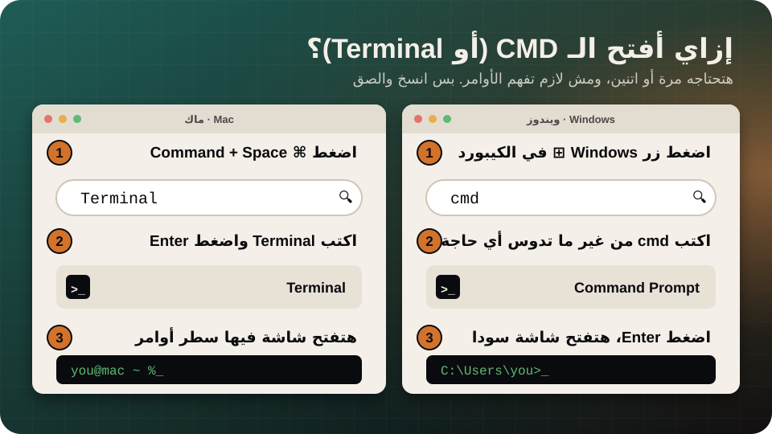
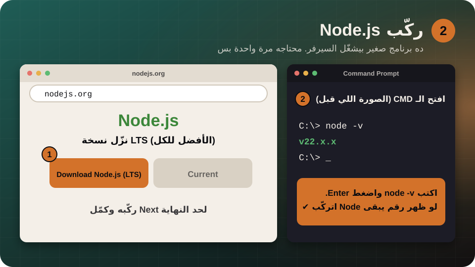
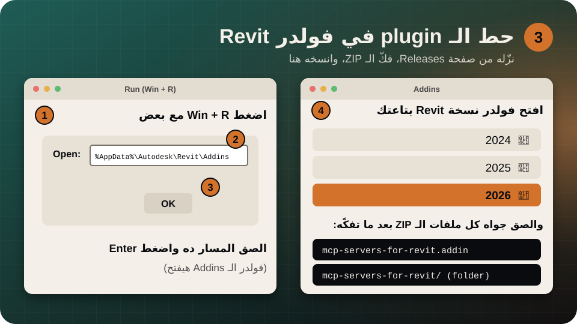
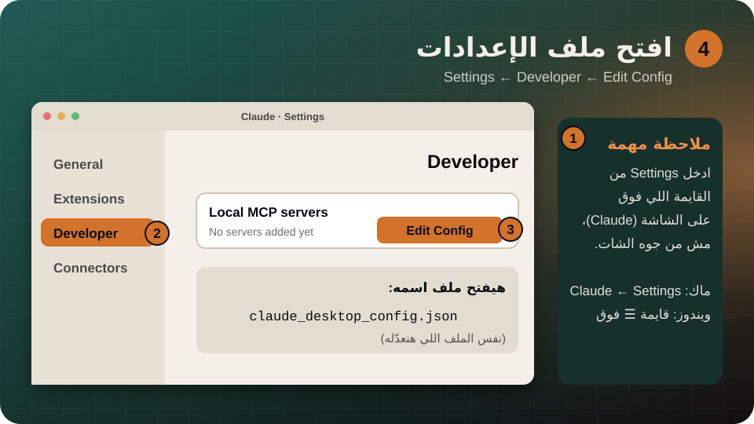
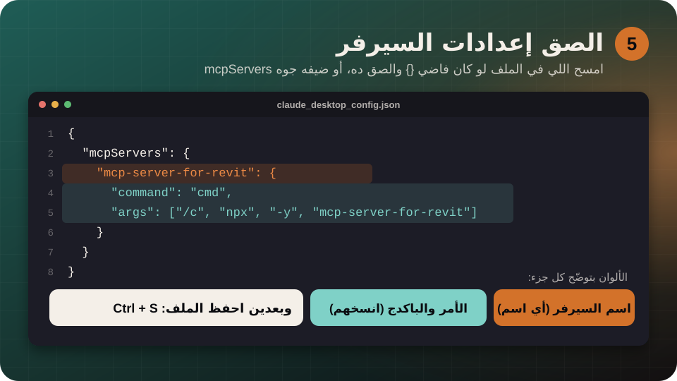
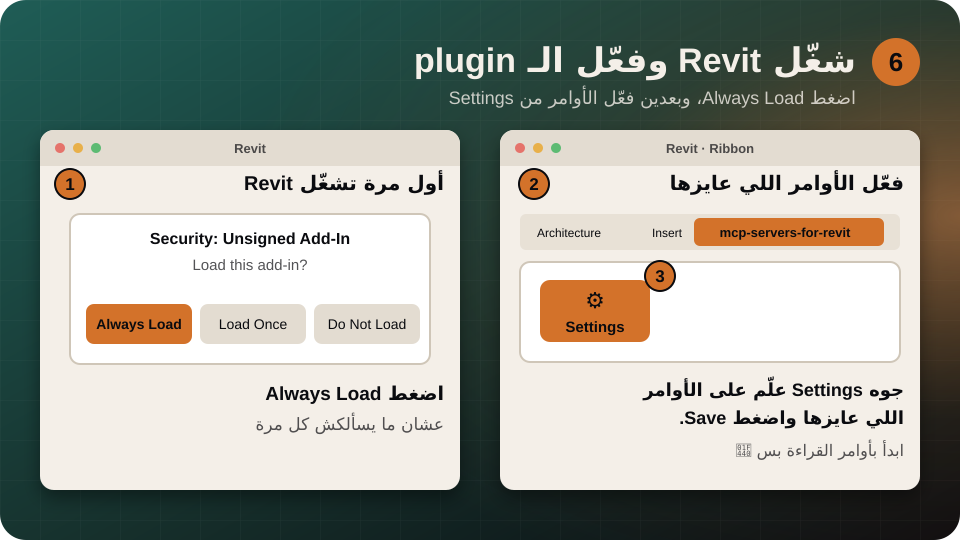

<div dir="rtl">

# 🇪🇬 دليل التركيب بالعربي

إزاي تخلّي Claude يشتغل جوه Revit (أو أي برنامج عمارة تاني) في حوالي 15 دقيقة، من غير ما تكون بتفهم برمجة.

[← الرجوع للقايمة](README.md) · [الدليل بالإنجليزي](GUIDE.md)


| | الطريقة | تنفع لمين | الوقت |
| :-- | :-- | :-- | :-- |
| ⭐ | [**الطريقة 1: Claude يركّب لك**](#way1) | أي سيرفر وأي برنامج. **ابدأ بيها.** | 5 دقايق |
| 🛠️ | [**الطريقة 2: بإيدك (مثال Revit)**](#way2) | لو الأولى وقفت، أو عايز تفهم إيه اللي بيحصل | 15 دقيقة |

> [!NOTE]
> الصور في الدليل رسومات مبسّطة. شاشتك ممكن تبان مختلفة شوية، لأن البرامج بتغيّر قوايمها من وقت للتاني.

---

## يعني إيه MCP وإيه اللي بنركّبه؟

**Claude** هو العقل. **السيرفر (MCP server)** برنامج صغير بيخلّي Claude يضغط أزرار في برنامجك. و**Revit** بيعمل الشغل. إنت بتتكلم مع Claude بكلام عادي وبس.

---

<a id="way1"></a>

## الطريقة 1: Claude يركّب لك


**1. افتح Claude Code.** ممكن من الترمنال، أو من تطبيق Claude. الأفضل Claude Code لأنه يقدر يشغّل الأوامر ويعدّل الملفات على جهازك، وده بالظبط اللي التركيب محتاجه.

**2. هات رابط السيرفر.** من [القايمة](README.md) اختار السيرفر اللي عايزه (مثلاً Revit)، وافتح صفحته على GitHub، وانسخ الرابط من شريط العنوان.

**3. الصق الرابط في Claude واكتب له الرسالة دي:**

</div>

```text
ركّب لي الـ MCP server ده على جهازي واتبع خطوات الـ README بتاعه خطوة خطوة،
واشرح لي أي حاجة لازم أعملها بإيدي: <الصق الرابط هنا>
```

<div dir="rtl">

**4. وافق على الأوامر بالواعي.** Claude هيسألك قبل ما يشغّل أي أمر. اقرا الأمر الأول، ولو مش فاهمه اسأله "ده بيعمل إيه؟" قبل ما تضغط **Allow**.

**5. اقفل Claude وافتحه من جديد.** وبعدين اسأله: `What tools do you have from this server?` لو رجّع قايمة أوامر يبقى السيرفر اشتغل ✅

> [!TIP]
> لو Claude قالّك "ركّب الـ plugin جوه Revit بإيدك"، كمّل من [الخطوة 3 و 6 في الطريقة 2](#step3) تحت.

---

## قبل ما نكمّل: إزاي أفتح الـ CMD (أو Terminal)؟

هتحتاجه مرة أو اتنين بس. ومش لازم تفهم الأوامر، انسخ واحدة واحدة والصق.



| النظام | الخطوات |
| :-- | :-- |
| **ويندوز** | اضغط زر **Windows ⊞** ← اكتب `cmd` ← اضغط **Enter**. هتفتح شاشة سودا. |
| **ماك** | اضغط **⌘ Command + Space** ← اكتب `Terminal` ← اضغط **Enter**. |

الصق أي أمر بكليك يمين في الشاشة السودا، أو `Ctrl + V`، وبعدين **Enter**.

---

<a id="way2"></a>

## الطريقة 2: بإيدك (مثال Revit)

هنركّب سيرفر [mcp-servers-for-revit](https://github.com/mcp-servers-for-revit/mcp-servers-for-revit). الخطوات هي هي لأي سيرفر تاني، بس بيتغيّر الـ plugin والإعدادات حسب README بتاعه.

**المطلوب قبل ما تبدأ:**

- ويندوز، لأن Revit بيشتغل على ويندوز بس.
- Revit من نسخة 2020 لـ 2026.
- حساب على Claude.

> [!WARNING]
> اشتغل على **نسخة** من المشروع، مش الأصلي. السيرفر ممكن يعدّل الموديل، فابدأ بأسئلة قراءة بس.

### 1. نزّل Claude Desktop


ادخل على [claude.ai/download](https://claude.ai/download)، اضغط **Download for Windows**، افتح الملف وركّبه، وسجّل دخول بحسابك.

<a id="step2"></a>

### 2. ركّب Node.js



1. ادخل على [nodejs.org](https://nodejs.org/) ونزّل نسخة **LTS**.
2. ركّبه واضغط **Next** لحد النهاية.
3. افتح **CMD** (شوف الصورة اللي فوق) واكتب الأمر ده:

</div>

```text
node -v
```

<div dir="rtl">

لو ظهر رقم زي `v22.x.x` يبقى Node اتركّب كويس. لو قالك "not recognized" اقفل الـ CMD وافتحه تاني، ولو لسه، اعمل Restart للكمبيوتر.

<a id="step3"></a>

### 3. حط الـ plugin في فولدر Revit



1. افتح صفحة [Releases](https://github.com/mcp-servers-for-revit/mcp-servers-for-revit/releases) بتاعة المشروع، ونزّل ملف الـ **ZIP** المناسب لنسخة Revit عندك (السنة مكتوبة على شاشة بداية Revit).
2. كليك يمين على الـ ZIP ← **Extract All** عشان تفكّه.
3. اضغط **Win + R** مع بعض، والصق المسار ده، واضغط **Enter**:

</div>

```text
%AppData%\Autodesk\Revit\Addins
```

<div dir="rtl">

4. افتح فولدر نسخة Revit بتاعتك (مثلاً `2026`). لو مش موجود، اعمل فولدر جديد بنفس اسم السنة.
5. انسخ **كل** اللي جوه الفولدر المفكوك (ملف `.addin` والفولدر اللي معاه) والصقه هنا.

### 4. افتح ملف إعدادات Claude



1. من **القايمة اللي فوق** في Claude (مش من جوه الشات) اختار **Settings**.
2. اضغط **Developer** من القايمة اللي على الجنب.
3. اضغط **Edit Config**. هيفتح ملف اسمه `claude_desktop_config.json`.

لو الزرار مش باين، الملف موجود هنا بإيدك:

</div>

```text
%APPDATA%\Claude\claude_desktop_config.json
```

<div dir="rtl">

### 5. الصق إعدادات السيرفر



لو الملف فاضي أو فيه `{}` بس، امسح اللي فيه والصق ده كله:

</div>

```json
{
  "mcpServers": {
    "mcp-server-for-revit": {
      "command": "cmd",
      "args": ["/c", "npx", "-y", "mcp-server-for-revit"]
    }
  }
}
```

<div dir="rtl">

لو فيه سيرفرات تانية متسجّلة قبل كده، **ما تمسحهاش**. ضيف الجزء ده جوه نفس `"mcpServers"` وحط فاصلة `,` بينهم. وبعدين اضغط **Ctrl + S** عشان تحفظ.

> [!TIP]
> لو خايف تغلط في الأقواس، الصق الملف في Claude واطلب منه "ضيف السيرفر ده لملف الإعدادات من غير ما تمسح اللي موجود".

### 6. شغّل Revit وفعّل الـ plugin



1. شغّل Revit. لو سألك عن add-in مش معروف اضغط **Always Load**.
2. هتلاقي تبويب جديد في الشريط اسمه **mcp-servers-for-revit**.
3. اضغط **Settings**، وعلّم على الأوامر اللي عايزها، واضغط **Save**. ابدأ بأوامر القراءة بس.

### 7. اقفل Claude وافتحه وجرّب


1. اقفل Claude **تماماً**. زرار الـ X مش كفاية. كليك يمين على أيقونة Claude جنب الساعة واختار **Quit**.
2. افتح Claude من جديد (ويكون Revit شغّال ومعاه موديل مفتوح).
3. اكتب أول سؤال:

</div>

```text
What can you do in Revit? List your tools.
```

<div dir="rtl">

لو Claude رجّع قايمة بأوامر Revit، **مبروك! الربط اشتغل** 🎉

أسئلة سهلة تبدأ بيها (قراءة بس):

- "اعرض لي كل الـ levels في الموديل."
- "وصّف لي اللي ظاهر في الـ view الحالي."
- "أنهي أبواب مش ليها fire rating؟"

---

## لو حاجة ما اشتغلتش

| المشكلة | الحل |
| :-- | :-- |
| السيرفر مش ظاهر في Claude | اقفل Claude بـ **Quit** كامل (مش بس الشباك) وافتحه تاني. |
| ظهر خطأ فيه `npx` أو `ENOENT` | Node.js مش متركّب صح. ارجع [للخطوة 2](#step2) وجرّب `node -v`، وبعدها اعمل Restart للكمبيوتر. |
| Claude بيقول إن ملف الإعدادات غلط | في قوس أو علامة اقتباس `"` أو فاصلة `,` ناقصة أو زيادة. الصق الملف في Claude واطلب منه يصلحه. |
| Claude متصل بس Revit مابيعملش حاجة | اتأكد إن Revit مفتوح وفيه موديل، وإن تبويب **mcp-servers-for-revit** ظاهر، وإن الأوامر متفعّلة في **Settings**. |
| اشتغل وبعدين وقف | شغّل السيرفر من برنامج AI واحد في المرة (مثلاً مش Claude و Cursor مع بعض). |

لسه واقف؟ اقفل Claude وافتح فولدر اللوجات بالأمر ده (Win + R):

</div>

```text
%APPDATA%\Claude\logs
```

<div dir="rtl">

وابعت الملفات `mcp.log` و `mcp-server-<الاسم>.log` لـ Claude واسأله إيه المشكلة.

---

## مهم للأمان

> [!CAUTION]
> السيرفر بيقدر يشغّل أوامر ويعدّل الموديل ويقرا ملفاتك. اشتغل دايماً على **نسخة** من المشروع، واقرا كل طلب إذن قبل ما توافق، وركّب بس سيرفرات إنت واثق في الكود بتاعها. معظم السيرفرات اللي في القايمة مشاريع مجتمع (community)، فاقرا README بتاع المشروع قبل التركيب.

## روابط رسمية

- [تنزيل Claude](https://claude.ai/download)
- [Node.js](https://nodejs.org/)
- [الدليل الكامل بالإنجليزي](GUIDE.md) (فيه كمان مثال Blender وطرق تانية للتركيب)
- [الاتصال بسيرفرات MCP المحلية (modelcontextprotocol.io)](https://modelcontextprotocol.io/docs/develop/connect-local-servers)

[← الرجوع للقايمة](README.md)

</div>
