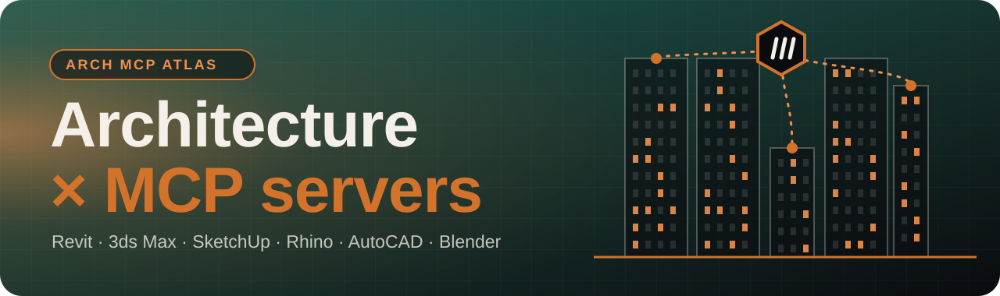
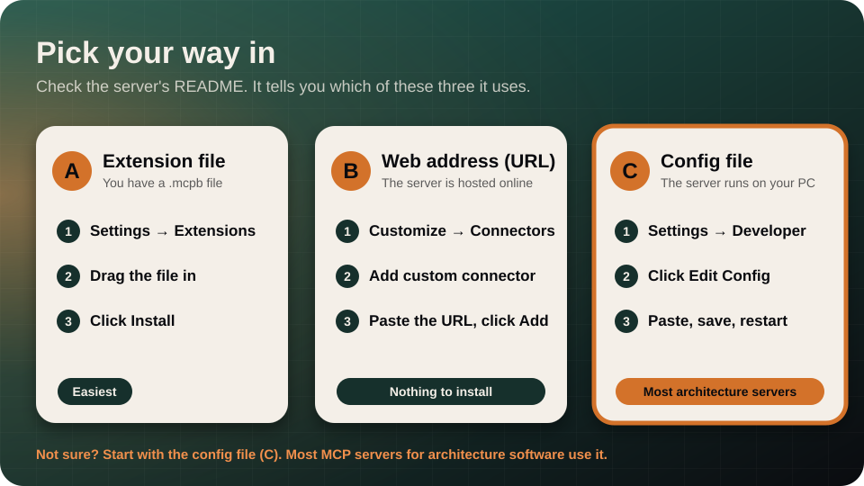

<div align="center">



<p>
  
  
  
</p>

**Arch MCP Atlas: a verified directory of MCP servers for architecture software.**<br>
Let Claude and other AI assistants work inside Revit, 3ds Max, SketchUp, Rhino, AutoCAD, Archicad, Blender and more.

[**Browse the searchable site →**](https://ahmakader.github.io/arch-mcp-atlas/) &nbsp;·&nbsp; [**Setup guide for beginners →**](GUIDE.md) &nbsp;·&nbsp; [Add a server](CONTRIBUTING.md) &nbsp;·&nbsp; [Raw data](data/servers.json)

</div>

---

## New to MCP? Start here

<a href="GUIDE.md"></a>

**[Open the setup guide →](GUIDE.md)** Five steps with pictures: install Claude Desktop, add a server, switch it on in your software (real examples for Revit and Blender), and check that it works. No coding needed. The same guide is on the [website](https://ahmakader.github.io/arch-mcp-atlas/guide.html).

<div dir="rtl">

## 🇪🇬 إزاي أركّب سيرفر؟ (بالعربي، خطوة بخطوة)

فيه طريقتين. ابدأ بالأولى لأنها الأسهل، ولو ما نفعتش جرّب التانية.

### الطريقة 1: الأسهل، خلّي Claude يركّب لك

1. افتح **Claude Code** (من الترمنال أو من تطبيق Claude). ده الأفضل لأنه يقدر يشغّل الأوامر ويعدّل الملفات على جهازك.
2. اختار السيرفر اللي عايزه من الجداول تحت، وافتح صفحته على GitHub، وانسخ الرابط.
3. الصق الرابط في Claude واكتب له:

</div>

```text
ركّب لي الـ MCP server ده على جهازي واتبع خطوات الـ README بتاعه خطوة خطوة،
واشرح لي أي حاجة لازم أعملها بإيدي: <الصق الرابط هنا>
```

<div dir="rtl">

4. Claude هيطلب إذنك قبل أي أمر. **اقرا كل طلب** قبل ما توافق.
5. لما يخلص، اقفل Claude تماماً وافتحه تاني، واسأله: `What tools do you have from this server?`

### الطريقة 2: بإيدك، مثال على Revit

هنركّب سيرفر [mcp-servers-for-revit](https://github.com/mcp-servers-for-revit/mcp-servers-for-revit). محتاج: ويندوز، Revit من 2020 لـ 2026، و[Node.js](https://nodejs.org/) (نزّل نسخة LTS).

**1. نزّل Claude Desktop.** من [claude.ai/download](https://claude.ai/download)، ركّبه وسجّل دخول بحسابك.

**2. ركّب الـ plugin في Revit.** افتح صفحة [Releases](https://github.com/mcp-servers-for-revit/mcp-servers-for-revit/releases) بتاعة المشروع، ونزّل ملف الـ ZIP المناسب لنسخة Revit عندك، وفكّه، وانسخ اللي جواه في الفولدر ده:

</div>

```text
%AppData%\Autodesk\Revit\Addins\<نسخة Revit بتاعتك>\
```

<div dir="rtl">

**3. ضيف السيرفر في Claude.** من القايمة اللي فوق في Claude اختار **Settings** ثم **Developer** ثم **Edit Config**. هيفتح ملف، الصق فيه ده واحفظ:

</div>

```json
{
  "mcpServers": {
    "mcp-server-for-revit": {
      "command": "cmd",
      "args": ["/c", "npx", "-y", "mcp-server-for-revit"]
    }
  }
}
```

<div dir="rtl">

لو في الملف سيرفرات تانية، ضيف ده جوه نفس الـ `"mcpServers"` وحط فاصلة بينهم.

**4. شغّل Revit.** لو سألك عن add-in مش معروف اضغط **Always Load**. بعدين افتح تبويب **mcp-servers-for-revit** في الشريط اللي فوق، واضغط **Settings**، وفعّل الأوامر اللي عايزها، واضغط **Save**.

**5. اقفل Claude تماماً وافتحه.** مش بس تقفل الشباك: كليك يمين على أيقونة Claude جنب الساعة واختار **Quit**، وافتحه تاني.

**6. جرّب.** افتح موديل (**نسخة منه، مش الأصلي**) واكتب لـ Claude: `What can you do in Revit? List your tools.` وابدأ بأسئلة قراءة بس، زي: "اعرض لي الـ levels اللي في الموديل".

لو حاجة ما اشتغلتش، بص على جدول المشاكل وحلولها في [الدليل الكامل](GUIDE.md#if-it-does-not-work) (بالإنجليزي). وبرضه لو كنت بتركّب برنامج تاني غير Revit (Blender, SketchUp, Rhino...)، الطريقة 1 هتمشي معاك على طول.

</div>

## What is this?

[MCP (Model Context Protocol)](https://modelcontextprotocol.io) is an open standard, introduced by Anthropic in November 2024, that lets an AI assistant call tools in other software. An **MCP server** is the small program that sits next to your application and exposes what it can do (create walls, read parameters, render a view) to the AI.

This list collects the ones that matter for architecture and AEC work, with what each is for, who maintains it and whether it is still alive. Each entry was checked on **2026-10-30** against its repository, vendor page or registry listing. A few vendor pages block automated access and were confirmed through secondary sources; treat those as less certain and always read the project's own README before installing.

**504 servers** in **11 categories**, **37** of them official from the software vendor.

## How to read the tables

| Mark | Meaning |
| :-- | :-- |
| 🟦 Official · 🟧 Company · ⬜ Community | Who made it: the software vendor, a company product, or an individual / community project |
| 🟢 / 🟡 / 🔴 / ⚪ | Last update within 6 months / within 12 months / older / unknown, relative to the verification date |
| ★ | GitHub stars when shown (– if not a GitHub project or not visible) |

> [!CAUTION]
> An MCP server can run commands and change your model. Start with read-only questions, work on a **copy** of the project, review what the AI does, and only install servers whose code you trust. Many of these are community projects that run scripts inside your CAD or BIM software.

## Coverage by software

Software with the most servers. Each link jumps to that software's servers in [BY_SOFTWARE.md](BY_SOFTWARE.md). The [searchable site](https://ahmakader.github.io/arch-mcp-atlas/) has more filters.

| | | | |
| :-- | :-- | :-- | :-- |
| [**Revit** · 45](BY_SOFTWARE.md#revit) | [**AutoCAD** · 35](BY_SOFTWARE.md#autocad) | [**Blender** · 31](BY_SOFTWARE.md#blender) | [**SketchUp** · 23](BY_SOFTWARE.md#sketchup) |
| [**Rhino** · 20](BY_SOFTWARE.md#rhino) | [**Fusion** · 18](BY_SOFTWARE.md#fusion) | [**Grasshopper** · 18](BY_SOFTWARE.md#grasshopper) | [**IFC** · 18](BY_SOFTWARE.md#ifc) |
| [**Civil 3D** · 15](BY_SOFTWARE.md#civil-3d) | [**FreeCAD** · 15](BY_SOFTWARE.md#freecad) | [**Maya** · 15](BY_SOFTWARE.md#maya) | [**DXF** · 14](BY_SOFTWARE.md#dxf) |
| [**Navisworks** · 14](BY_SOFTWARE.md#navisworks) | [**IfcOpenShell** · 12](BY_SOFTWARE.md#ifcopenshell) | [**ZWCAD** · 12](BY_SOFTWARE.md#zwcad) | [**Autodesk Construction Cloud** · 11](BY_SOFTWARE.md#autodesk-construction-cloud) |
| [**3ds Max** · 10](BY_SOFTWARE.md#3ds-max) | [**Inventor** · 10](BY_SOFTWARE.md#inventor) | [**Onshape** · 9](BY_SOFTWARE.md#onshape) | [**DWG** · 8](BY_SOFTWARE.md#dwg) |
| [**QGIS** · 8](BY_SOFTWARE.md#qgis) | [**Unity** · 8](BY_SOFTWARE.md#unity) | [**Unreal Engine** · 8](BY_SOFTWARE.md#unreal-engine) | [**Figma** · 7](BY_SOFTWARE.md#figma) |

## Contents

- [🏛️ BIM authoring](#bim-authoring)  <sub>57</sub>
- [📐 CAD / drafting](#cad--drafting)  <sub>85</sub>
- [🧊 3D modeling & rendering](#3d-modeling--rendering)  <sub>152</sub>
- [🧱 OpenBIM / IFC](#openbim--ifc)  <sub>21</sub>
- [🗺️ GIS & site analysis](#gis--site-analysis)  <sub>39</sub>
- [📊 Structural & energy analysis](#structural--energy-analysis)  <sub>17</sub>
- [🏗️ Construction management](#construction-management)  <sub>36</sub>
- [☁️ Cloud / APIs](#cloud--apis)  <sub>12</sub>
- [🎨 Presentation & design tools](#presentation--design-tools)  <sub>33</sub>
- [✨ AI imagery & 3D generation](#ai-imagery--3d-generation)  <sub>28</sub>
- [🧰 Other](#other)  <sub>24</sub>

## The best of each category

Official and company servers come first, then community projects by GitHub stars. Only the top 10 per category are shown here; **everything is in the [full catalog](CATALOG.md)**.

### BIM authoring

🏛️ Create, query and edit building models: Revit, Archicad, Vectorworks and friends.

| Server | Works with | Type | ★ | Updated | What it does |
| :-- | :-- | :-- | --: | :-- | :-- |
| [Archicad Public MCP Server (Beta) / AI Assistant MCP](https://help.graphisoft.com/AC/30/INT/Topics/001_GettingHelp/AI_Assistant/public_mcp_connection.html) | Archicad 30 | 🟦 Official | – | ⚪ – | Archicad 30 built-in beta MCP server that lets compatible desktop AI tools (Claude Desktop, Cursor, ChatGPT Desktop, VS Code) read and manage BIM elements in open projects via stdio. |
| [Autodesk Revit MCP Server (Revit 2027 public MCP, Technical Preview)](https://blog.autodesk.io/revit-mcp-server-update/) | Revit | 🟦 Official | – | 🟢 2026-09-29 | Autodesk's own add-on (Technical Preview) that exposes an open Revit 2027 model to MCP clients such as Claude Desktop or Cursor over local STDIO |
| [Horizun Revit MCP](https://github.com/HorizunGroup/horizun-revit-mcp) | Revit | 🟧 Company | 65 | 🟢 2026-10-22 | Free open-source Windows MCP server and Revit add-in for typed BIM edits, families, drawings, CAD-to-BIM, audits, quantities, Excel, Power BI and exports; README states 125 tools and 481 named suboperations. |
| [NavisCoord](https://github.com/HorizunGroup/naviscoord-mcp) | Navisworks | 🟧 Company | 20 | 🟢 2026-10-20 | Open-source MCP server and Navisworks add-in for clash coordination that works with ChatGPT Desktop, Claude Desktop, Claude Code and Codex. |
| [AI Connector for Revit (NonicaTab)](https://github.com/NonicaTeam/AI-Connector-for-Revit) | Revit | 🟧 Company | 19 | 🟢 2026-10-07 | Commercial NonicaTab feature that connects Claude, Cursor or Copilot to Revit through 50+ predefined tools to inspect, select, edit and document elements; the GitHub repo only tracks issues and releases. |
| [AEC Pilot MCP](https://github.com/hmertkaramann/aec-pilot-mcp) | Revit, AutoCAD, Civil 3D, Navisworks, 3ds Max | 🟧 Company | 2 | 🟢 2026-10-15 | Commercial local MCP server running inside each Autodesk app (Revit, AutoCAD, Civil 3D, Navisworks and more); README states 480+ actions. |
| [Revit Converter MCP (Labs Future)](https://github.com/labsfuture/revit-converter-remote-mcp-release) | Revit | 🟧 Company | 1 | 🟢 2026-05-26 | Remote MCP server that converts uploaded .rvt files to XKT, IFC or DWG and answers natural-language BIM queries about the stored models. |
| [vn-revit-mcp (InnoPro)](https://github.com/Innoprovn/vn-revit-mcp) | Revit | 🟧 Company | 1 | 🟢 2026-10-15 | Open-source MCP server and Revit add-in (Vietnamese-language docs) with in-Revit chat, commands writable as single .cs files, undoable model edits and a Revit API lookup skill. |
| [Revit MCP by ArchBench](https://github.com/3d-mcp/revit-mcp) | Revit | 🟧 Company | 0 | 🟢 2026-09-13 | Independent experimental Revit connector using pyRevit, with read-only or write bridge modes and an opt-in code-execution tool; alpha release. |
| [ScanBIM Revit MCP](https://github.com/ScanBIM-Labs/revit-mcp) | Revit | 🟧 Company | 0 | 🟢 2026-04-21 | Hosted Cloudflare Worker MCP server that works on uploaded Revit files via Autodesk Platform Services: elements, parameters, schedules, clash detection and IFC export. |

<sub>…and **47** more in the [full catalog](CATALOG.md).</sub>

### CAD / drafting

📐 2D/3D drafting and DWG/DXF automation: AutoCAD, FreeCAD, SolidWorks and general CAD.

| Server | Works with | Type | ★ | Updated | What it does |
| :-- | :-- | :-- | --: | :-- | :-- |
| [Autodesk AutoCAD and Civil 3D MCP Server (Tech Preview)](https://help.autodesk.com/view/ADSKMCP/ENU/) | AutoCAD, Civil 3D | 🟦 Official | – | ⚪ – | Autodesk's local MCP server (Tech Preview / public beta) that runs inside AutoCAD or Civil 3D (AutoCAD 2027 era, Windows) so AI assistants can query, analyze, navigate and modify objects in the open drawing, check… |
| [Bentley MicroStation MCP Server (early access)](https://www.bentley.com/en/infrastructure-ai/mcp-servers/) | MicroStation | 🟦 Official | – | ⚪ – | Bentley MCP server giving AI agents read/write access to DGN content through the MicroStation Python API; early access to a restricted group of users. |
| [Aspicio](https://github.com/frontsail-ai/aspicio) | DXF, vector PDF | 🟧 Company | 6 | 🟢 2026-10-23 | TypeScript DXF/vector-PDF viewer and engine usable by AI agents. |
| [CADaddy](https://github.com/AICodeForgedev/cadaddy) | DWG, DXF | 🟧 Company | 2 | 🟢 2026-10-21 | Free Rust 2D CAD app that opens and saves DWG/DXF and exposes an MCP interface for AI agents; source-available (FSL-1.1). |
| [cadlens-mcp](https://github.com/cadlens-co/cadlens-mcp) | DWG, DXF, DWF, Cadlens API | 🟧 Company | 1 | 🟢 2026-08-11 | MCP wrapper for the hosted Cadlens CAD parsing API that converts DWG/DXF/DWF drawings into structured JSON for agents. |
| [Skopia floor-plan layout](https://github.com/Skopia-mcp/Skopia-mcp) | DXF, AutoCAD, Revit | 🟧 Company | 0 | 🟢 2026-09-18 | Hosted MCP engine that draws a floor plan in real millimetres and projects consistent sections and elevations, exporting SVG, sheets or DXF. |
| [CAD-MCP (daobataotie)](https://github.com/daobataotie/CAD-MCP) | AutoCAD, GstarCAD, ZWCAD | ⬜ Community | 654 | 🟢 2026-10-27 | MCP server controlling AutoCAD and other CAD programs through natural language; v2.0 README states 35 tools covering query, editing, layers, blocks and command passthrough. |
| [autocad-mcp (puran-water, AutoCAD LT)](https://github.com/puran-water/autocad-mcp) | AutoCAD LT, AutoCAD | ⬜ Community | 606 | 🟡 2026-02-20 | MCP server for AutoCAD LT with freehand AutoLISP via file IPC, plus a headless ezdxf backend for DXF generation on any OS. |
| [Easy-MCP-AutoCad](https://github.com/zh19980811/Easy-MCP-AutoCad) | AutoCAD | ⬜ Community | 266 | 🟢 2026-10-15 | Chinese/English AutoCAD MCP integration server; README says it is not actively maintained. |
| [AutoCAD MCP Pro (U-C4N/Autocad-MCP)](https://github.com/U-C4N/autocad-mcp) | AutoCAD | ⬜ Community | 203 | 🟢 2026-10-26 | Python MCP server with a live COM engine on Windows and a headless ezdxf engine; v1.7 README states 248 registered tools. |

<sub>…and **75** more in the [full catalog](CATALOG.md).</sub>

### 3D modeling & rendering

🧊 Modeling, scenes and renders: Rhino, SketchUp, 3ds Max, Blender, Unreal, Twinmotion.

| Server | Works with | Type | ★ | Updated | What it does |
| :-- | :-- | :-- | --: | :-- | :-- |
| [RhinoAI (McNeel Rhino MCP)](https://github.com/mcneel/RhinoAI) | Rhino, Grasshopper | 🟦 Official | 387 | 🟢 2026-10-29 | Free MIT-licensed plugin and MCP server from McNeel that connects Rhino and Grasshopper to Claude, Copilot, Codex, Gemini or local LLMs to create geometry, run commands, edit scripts and build Grasshopper… |
| [Autodesk Fusion MCP](https://github.com/Autodesk/ai-integrations/tree/main/fusion/local-mcp-server) | Fusion | 🟦 Official | 0 | 🟢 2026-10-29 | Thin stdio bridge (MCPB bundle for Claude Desktop, or direct URL for Cursor) to the MCP server built into the Autodesk Fusion desktop app, for creating, modifying and inspecting geometry in a running Fusion session. |
| [Blender Lab MCP Server (official)](https://www.blender.org/lab/mcp-server/) | Blender | 🟦 Official | – | ⚪ – | Official Blender MCP server and companion add-on that give an LLM a natural-language interface to Blender's Python API, docs and scene; the page warns it runs LLM-generated code with no safeguards. |
| [Cinema 4D built-in MCP server (Maxon)](https://support.maxon.net/hc/en-us/articles/30880484903452-Cinema-4D-2026-4-0-September-30-2026) | Cinema 4D | 🟦 Official | – | ⚪ – | Maxon's MCP server built into Cinema 4D 2026.4+, off by default, token-protected, with selectable tool groups, Python-execution controls and undo-grouped actions (per press coverage). |
| [Trimble SketchUp Connector (MCP)](https://news.trimble.com/2026-04-28-Trimble-Links-SketchUp-with-Anthropics-Claude,-Bringing-New-Conversational-AI-powered-Capabilities-to-3D-Modeling) | SketchUp | 🟦 Official | – | 🟢 2026-04-28 | Trimble-hosted remote MCP connector (announced 2026-04-28) that lets Claude build SketchUp (.skp) models in a cloud session from text and images and return a preview and download link. |
| [Unity MCP Server (official, AI Assistant package)](https://docs.unity3d.com/Packages/com.unity.ai.assistant@2.19/manual/integration/unity-mcp-overview.html) | Unity | 🟦 Official | – | ⚪ – | Unity Editor acts as an MCP server (relay binary plus editor bridge) exposing scene, asset, script and console tools; DEPRECATED by Unity in favour of the Unity CLI (`unity mcp`), see Unity's migration page. |
| [MCP for Unity](https://github.com/CoplayDev/unity-mcp) | Unity | 🟧 Company | 15.6k | 🟢 2026-10-19 | Most-starred Unity MCP bridge; manage assets, control scenes, edit scripts and run tests from an MCP client, not affiliated with Unity Technologies. |
| [Flopperam Unreal Engine MCP](https://github.com/flopperam/unreal-engine-mcp) | Unreal Engine | 🟧 Company | 1.1k | 🟢 2026-06-26 | Unreal Editor MCP with a hosted version and an open-source local Python version (50+ tools across 9 domains per README); README says the project is now owned by Aura. |
| [EngineWire / Unreal Engine MCP](https://github.com/ChiR24/Unreal_mcp) | Unreal Engine | 🟧 Company | 997 | 🟢 2026-10-30 | MCP server plus native C++ Automation Bridge plugin to drive a live Unreal Editor (levels, Blueprints, UI, materials, effects); README says Unreal 5.0-5.8 and a single tool with over 400 capabilities in 0.6.0. |
| [AnkleBreaker Unity MCP](https://github.com/AnkleBreaker-Studio/unity-mcp-server) | Unity | 🟧 Company | 531 | 🟢 2026-10-23 | Unity MCP server and editor plugin for scene authoring, tests and builds; README cites 80 exposed tools plus advanced on-demand tools. |

<sub>…and **142** more in the [full catalog](CATALOG.md).</sub>

### OpenBIM / IFC

🧱 Open standards: read, check and author IFC models.

| Server | Works with | Type | ★ | Updated | What it does |
| :-- | :-- | :-- | --: | :-- | :-- |
| [IfcMCP (ifcopenshell-mcp)](https://github.com/IfcOpenShell/IfcOpenShell/tree/v0.9.0/src/ifcmcp) | IfcOpenShell, IFC | 🟦 Official | 2.9k | 🟢 2026-09-29 | MCP server in the IfcOpenShell monorepo that wraps ifcquery and ifcedit and keeps an IFC model in memory across calls for querying, validating, clash checking, quantifying and editing. |
| [construction-iso-19650-mcp](https://github.com/CSOAI-ORG/construction-iso-19650-mcp) | ISO 19650, UK BIM Level 2 | 🟧 Company | 0 | 🟢 2026-06-26 | MCP server advertised for UK BIM Level 2 / ISO 19650 compliance (EIR, BEP, MIDP, CDE validation); README is generic template text so depth is unverified. |
| [ifc-lite (with MCP server)](https://github.com/LTplus-AG/ifc-lite) | IFC, WebGPU viewer, TypeScript SDK | ⬜ Community | 454 | 🟢 2026-10-30 | IFC toolkit (viewer, SDK, CLI, Rust/WASM core) whose CLI can start an MCP server so agents can query and edit BIM data. |
| [ifc-bonsai-mcp (Show2Instruct)](https://github.com/Show2Instruct/ifc-bonsai-mcp) | Blender, Bonsai (BlenderBIM), IfcOpenShell, IFC | ⬜ Community | 68 | 🟢 2026-07-10 | Original MCP4IFC research server connecting LLMs to Bonsai in Blender to read, create and edit IFC elements; README says it is superseded by bonsai-mcp but kept for reproducibility. |
| [Bonsai_mcp (JotaDeRodriguez)](https://github.com/JotaDeRodriguez/Bonsai_mcp) | Blender, Bonsai (BlenderBIM), IfcOpenShell, IFC | ⬜ Community | 66 | 🟢 2026-09-06 | Fork of BlenderMCP that adds IFC-specific tools (project info, spatial structure, properties, relationships, quantities) through Bonsai plus Blender code execution. |
| [openbim-mcp (Fragment MCP Server)](https://github.com/helenkwok/openbim-mcp) | That Open / web-ifc fragments, IFC | ⬜ Community | 39 | 🔴 2025-09-18 | MCP server that converts IFC files to the fragment format, loads fragments and queries BIM elements by IFC category. |
| [ifcMCP (smartaec)](https://github.com/smartaec/ifcmcp) | IFC, IfcOpenShell | ⬜ Community | 34 | 🔴 2025-06-08 | FastMCP server that lets LLM agents query IFC files through IfcOpenShell (entities, properties, locations, spatial containment, wall openings, space boundaries). |
| [ifc-ids-mcp (IDS MCP Server)](https://github.com/vinnividivicci/ifc-ids-mcp) | IDS, IfcOpenShell (IfcTester), IFC | ⬜ Community | 28 | 🟢 2026-04-06 | MCP server that creates, validates and manages buildingSMART IDS 1.0 files deterministically using IfcOpenShell's IfcTester. |
| [ifcx-mcp (louistrue)](https://github.com/louistrue/ifcx-mcp) | IFC5 / IFCX, IDS, BCF, bSDD | ⬜ Community | 25 | 🟢 2026-04-12 | MCP server for authoring IFC5/IFCX models in memory (spatial tree, types, geometry hints, materials, classifications) with IDS validation, BCF export and glTF preview. |
| [bonsai-mcp (Show2Instruct)](https://github.com/Show2Instruct/bonsai-mcp) | Blender, Bonsai (BlenderBIM), IfcOpenShell, IFC | ⬜ Community | 13 | 🟢 2026-08-20 | Local MCP server that bridges MCP clients to a running Blender + Bonsai session to inspect the scene, query the loaded IFC project, capture the viewport and run guarded Python code in Blender. |

<sub>…and **11** more in the [full catalog](CATALOG.md).</sub>

### GIS & site analysis

🗺️ Maps, parcels and context for site analysis.

| Server | Works with | Type | ★ | Updated | What it does |
| :-- | :-- | :-- | --: | :-- | :-- |
| [mapbox-mcp-server](https://github.com/mapbox/mcp-server) | Mapbox | 🟦 Official | 363 | 🟢 2026-10-30 | Official Mapbox MCP server: geocoding, POI search, directions, isochrones and interactive map rendering, usable for site context and accessibility studies. |
| [MCP for ArcGIS Location Services (beta)](https://developers.arcgis.com/ai-tools/mcp-arcgis-location-services/) | ArcGIS Location Platform, ArcGIS Online, ArcGIS Enterprise | 🟦 Official | – | ⚪ – | Esri-hosted MCP server exposing ArcGIS Location Services for geocoding, reverse geocoding, routing, elevation and static map images; marked beta. |
| [Geospatial Power Pack for Kiro](https://github.com/aws-samples/sample-geospatial-kiro-power-pack) | STAC, H3/S2, point cloud, 3D | 🟧 Company | 23 | 🟢 2026-09-24 | AWS sample bundling modular geospatial MCP servers (data connectors, CRS/geometry/raster/point-cloud/3D processing) with a Kiro hub. |
| [arcgis-mcp-server (Esri Saudi Arabia)](https://github.com/esrisaudiarabia/esrisaudiarabia-mcp) | ArcGIS Online, ArcGIS Enterprise | 🟧 Company | 2 | 🟡 2025-10-08 | Content-search MCP server for ArcGIS Portal/Online items using user credentials; published on PyPI by Esri Saudi Arabia. |
| [Catastro GPS MCP (parcelgps)](https://github.com/TheHiddenPandaDev/catastro_gps_mcp) | Cadastre | 🟧 Company | 1 | 🟢 2026-10-29 | MCP server returning official cadastral parcels from 29 European countries by reference, coordinates or address, with relief, climate normals and solar potential. |
| [AddressIntel MCP (SF Peninsula permits)](https://github.com/RantumBits/addressintel-mcp) | Building permits, Zoning | 🟧 Company | 0 | 🟢 2026-08-19 | Read-only MCP client for the AddressIntel API: SF Peninsula building permits and parcel buildability (SB 9, ADU, redevelopment envelope). |
| [Atlasly MCP](https://atlasly.app/mcp) | Site analysis | 🟧 Company | – | ⚪ – | Hosted MCP for UK site research for architects and planners: screening, boundary checks, flood and heritage, planning sources and point elevation. |
| [BumiAtlas Indonesia ATR/BPN parcels MCP](https://github.com/BumiAtlas/atrbpn-land-parcel-mcp) | Cadastre, Zoning | 🟧 Company | 0 | 🟢 2026-10-15 | Indonesian ATR/BPN land parcels by certificate number, NIB or coordinates, with overlaps and flood data. |
| [BumiAtlas Indonesia OSS RDTR zoning MCP](https://github.com/BumiAtlas/oss-rdtr-zoning-mcp) | Cadastre, Zoning | 🟧 Company | 0 | 🟢 2026-10-14 | Indonesian OSS RDTR detailed spatial-plan zoning at a point, with zone summaries. |
| [BumiAtlas Malaysia MCP](https://github.com/BumiAtlas/malaysia-land-zoning-mcp) | Cadastre, Zoning | 🟧 Company | 0 | 🟢 2026-10-25 | Malaysian JUPEM land lots and PLANMalaysia local-plan zoning by UPI, lot number or coordinates, with map images. |

<sub>…and **29** more in the [full catalog](CATALOG.md).</sub>

### Structural & energy analysis

📊 Structural, energy and daylight analysis tools.

| Server | Works with | Type | ★ | Updated | What it does |
| :-- | :-- | :-- | --: | :-- | :-- |
| [EnergyPlus-MCP](https://github.com/LBNL-ETA/EnergyPlus-MCP) | EnergyPlus | 🟦 Official | 124 | 🟢 2026-05-07 | MCP server with 35 tools to load, validate, modify and simulate EnergyPlus IDF models. |
| [OpenStudio-MCP](https://github.com/NatLabRockies/openstudio-mcp) | OpenStudio, EnergyPlus | 🟦 Official | 57 | 🟢 2026-10-28 | MCP server to create, query and modify OpenStudio building energy models, run EnergyPlus and read results; README states 150+ tools. |
| [OpenSTAAD MCP Server](https://github.com/BentleySystems/openstaad-mcp) | STAAD.Pro | 🟦 Official | 54 | 🟢 2026-10-22 | Bentley's MCP server for STAAD.Pro via the OpenSTAAD API, with a code-execution tool and API guidance tools. |
| [dlubal-mcp](https://pypi.org/project/dlubal-mcp/) | RFEM 6, RSTAB 9, RSECTION 1 | 🟦 Official | – | 🟢 2026-10-30 | MCP server for running Dlubal applications via the dlubal.api gRPC client, with script tools and a read-only results tool. |
| [LUSAS MCP Server](https://github.com/LUSAS-Software/LUSAS-MCP-Server) | LUSAS | 🟧 Company | 7 | 🟢 2026-10-05 | Official MCP server connecting AI assistants to LUSAS for structural FEA model inspection, library/manual search, LPython scripting and results extraction. |
| [TheNewEngineer HVAC MCP](https://thenewengineer.com/ai) | HVAC | 🟧 Company | – | ⚪ – | Hosted MCP connector of HVAC calculation engines for building services (e.g. expansion vessel sizing); registry description also mentions IFC duct networks. |
| [FEA-MCP (GreatApo, superseded)](https://github.com/GreatApo/FEA-MCP) | ETABS, LUSAS | ⬜ Community | 20 | 🟢 2026-10-05 | Unified MCP server for finite element modelling of frames, surfaces and solids in ETABS and LUSAS; README says it is superseded by LUSAS-MCP-Server. |
| [etabs-mcp (Moha2005269)](https://github.com/Moha2005269/etabs-mcp) | CSI ETABS | ⬜ Community | 19 | 🟢 2026-10-18 | Agentic MCP server for CSI ETABS v22+ to model, load, analyse, design and inspect structures through the official ETABS API. |
| [Honeybee-MCP](https://github.com/LoftyTao/Honeybee-MCP) | Honeybee, Ladybug Tools, Grasshopper | ⬜ Community | 17 | 🟡 2026-03-10 | FastMCP server exposing the Ladybug Tools/Honeybee building-energy modeling ecosystem; loads HBJSON or Grasshopper shared-memory models and edits, queries and simulates them. |
| [idfkit-mcp](https://github.com/idfkit/idfkit-mcp) | EnergyPlus | ⬜ Community | 13 | 🟢 2026-10-28 | MCP server to build, edit, validate and simulate EnergyPlus models (IDF/epJSON) and search EnergyPlus docs, covering versions 8.9 to 26.2. |

<sub>…and **7** more in the [full catalog](CATALOG.md).</sub>

### Construction management

🏗️ Clash detection, RFIs, issues, sheets and project platforms.

| Server | Works with | Type | ★ | Updated | What it does |
| :-- | :-- | :-- | --: | :-- | :-- |
| [aps-mcp-app-example](https://github.com/autodesk-platform-services/aps-mcp-app-example) | Autodesk Construction Cloud, APS Viewer, MCP Apps | 🟦 Official | 21 | 🟢 2026-04-21 | Example MCP server with MCP Apps support that browses ACC projects and designs and shows an interactive APS Viewer preview; a live demo is hosted by Autodesk. |
| [Bluebeam Revu MCP server](https://support.bluebeam.com/revu/resources/revu-mcp.html) | Bluebeam Revu | 🟦 Official | – | ⚪ – | Built-in local MCP server in Bluebeam Revu 21.9+ (Max plan) with dozens of tools for markups, text extraction, search, stamping, bookmarks, redaction, page scale and Studio Project access. |
| [Revizto MCP Server](https://revizto.com/resources/blog/introducing-mcp-server) | Revizto | 🟦 Official | – | 🟢 2026-07-24 | Hosted Revizto MCP server giving AI tools read access to issues, clashes, stamp templates and model/object properties and write access to issues. |
| [ScanBIM MCP (AI Hub for AEC)](https://github.com/ScanBIM-Labs/scanbim-mcp) | Revit, Navisworks, Autodesk Construction Cloud, Autodesk Platform Services, Twinmotion | 🟧 Company | 6 | 🟢 2026-04-21 | Hosted Cloudflare Workers hub of MCP servers for AEC; README describes 46 tools across 5 workers covering model upload/viewing, clashes, ACC, Revit, XR and RFIs. |
| [ACC MCP (ScanBIM Labs)](https://github.com/ScanBIM-Labs/acc-mcp) | Autodesk Construction Cloud, BIM 360 | 🟧 Company | 0 | 🟢 2026-04-21 | Hosted MCP worker for Autodesk Construction Cloud issues, RFIs and document search via APS (9 tools). |
| [Aginera MCP](https://aginera.ai/agents) | Construction drawings (PDF), DXF/DWG | 🟧 Company | – | ⚪ – | Hosted MCP server for preconstruction: run and read takeoffs on drawing sets, return measured routes and schedules, export quantities, convert PDF drawings to CAD and render floor plans. |
| [Contech-AI](https://github.com/entech-labs/Contech-AI) | Autodesk Construction Cloud | 🟧 Company | 0 | 🟢 2026-09-25 | Read-only Claude Desktop connector (local acc_mcp.py) that answers questions about ACC RFIs, issues, submittals, cost, members and documents using the user's Autodesk login. |
| [Estimaite MCP](https://github.com/nickpanagios/estimaite-mcp) | Construction drawing PDFs | 🟧 Company | 0 | 🟢 2026-08-05 | Hosted remote MCP server that measures and counts scope on a drawing PDF by trade, prices it and exports an estimate; the repo holds only the manifest and docs. |
| [Land Takeoffs MCP](https://github.com/landtakeoffs/land-takeoffs-mcp) | Civil plan sets, DWG, DXF, LandXML | 🟧 Company | 0 | 🟢 2026-10-16 | Hosted remote MCP that returns sitework quantities (storm, sewer, water, paving, cut/fill) from civil plan-set PDFs and CAD files with an Excel bid sheet. |
| [Navisworks MCP (ScanBIM Labs)](https://github.com/ScanBIM-Labs/navisworks-mcp) | Navisworks, Autodesk Platform Services | 🟧 Company | 0 | 🟢 2026-04-21 | MCP worker for multi-file coordination, clash detection and viewpoints via APS (repo About text). |

<sub>…and **26** more in the [full catalog](CATALOG.md).</sub>

### Cloud / APIs

☁️ Cloud platforms and vendor APIs (Autodesk Platform Services and similar).

| Server | Works with | Type | ★ | Updated | What it does |
| :-- | :-- | :-- | --: | :-- | :-- |
| [aps-aecdm-mcp-dotnet](https://github.com/autodesk-platform-services/aps-aecdm-mcp-dotnet) | APS, AEC Data Model | 🟦 Official | 40 | 🟡 2026-03-19 | .NET MCP server sample connecting Claude Desktop to the AEC Data Model API and the APS Viewer. |
| [APS MCP Server (aps-mcp-server-nodejs)](https://github.com/autodesk-platform-services/aps-mcp-server-nodejs) | Autodesk Construction Cloud, Autodesk Platform Services | 🟦 Official | 25 | 🟢 2026-05-07 | Sample MCP server from Autodesk Platform Services that gives AI clients access to ACC project data through the Data Management and ACC APIs, authenticated with Secure Service Accounts. |
| [aps-sample-mcp-server-revit-automation](https://github.com/autodesk-platform-services/aps-sample-mcp-server-revit-automation) | Revit, APS | 🟦 Official | 10 | 🟡 2026-03-09 | Sample remote HTTP MCP server that automates Revit through the APS Automation API using Secure Service Account auth; README calls it an exploratory vibe-coded proof of concept. |
| [aps-mcp-auth-examples](https://github.com/autodesk-platform-services/aps-mcp-auth-examples) | APS, Autodesk Construction Cloud | 🟦 Official | 9 | 🟢 2026-09-25 | Reference MCP servers for Autodesk Platform Services showing 2LO, 3LO, PKCE and Secure Service Account auth, with STDIO or HTTP client authentication targeting the 2026-07-28 MCP spec. |
| [aps-mcp-server-python](https://github.com/autodesk-platform-services/aps-mcp-server-python) | APS | 🟦 Official | 4 | 🟡 2026-03-17 | Three minimal FastMCP servers demonstrating 2-legged, Secure Service Account and 3-legged auth for calling APS Data Management and OSS APIs. |
| [aps-aecdm-plant3D-mcp-python](https://github.com/autodesk-platform-services/aps-aecdm-plant3D-mcp-python) | Plant 3D, APS | 🟦 Official | 0 | 🟢 2026-10-15 | Read-only Python MCP server exposing Plant 3D design data through the AEC Data Model GraphQL API: hubs, projects, elements, properties, ProcessPower schema and relationships. |
| [Zoo MCP](https://github.com/KittyCAD/mcp) | Zoo CAD API | 🟧 Company | 11 | 🟢 2026-10-29 | MCP server exposing Zoo (KittyCAD) CAD utilities. |
| [ARCAT Building Products](https://smithery.ai/servers/arcat/building-product-bim-cad-specs) | ARCAT | 🟧 Company | – | ⚪ – | Hosted MCP for the ARCAT building-product database (500+ manufacturers) with BIM/CAD/spec product and CSI section search. |
| [aps-mcp-server (petrbroz, moved)](https://github.com/petrbroz/aps-mcp-server) | Autodesk Construction Cloud, BIM 360 | ⬜ Community | 41 | 🟡 2025-10-29 | Earlier experimental APS MCP server using Secure Service Accounts; README says the project moved to autodesk-platform-services/aps-mcp-server-nodejs. |
| [speckle-mcp (bimgeek)](https://github.com/bimgeek/speckle-mcp) | Speckle | ⬜ Community | 14 | 🔴 2025-08-23 | Python MCP server for Speckle; repository README is empty, pyproject describes it as an MCP server for Speckle integration (directory listings describe project and model-version access). |

<sub>…and **2** more in the [full catalog](CATALOG.md).</sub>

### Presentation & design tools

🎨 Photoshop, Illustrator, InDesign, Figma, Canva and whiteboards for boards, drawings and review.

| Server | Works with | Type | ★ | Updated | What it does |
| :-- | :-- | :-- | --: | :-- | :-- |
| [Excalidraw MCP App (official)](https://github.com/excalidraw/excalidraw-mcp) | Excalidraw | 🟦 Official | 5.6k | 🟡 2026-03-24 | Excalidraw MCP App server (remote https://mcp.excalidraw.com or local) streaming hand-drawn diagrams with interactive editing, useful for sketching and review. |
| [Figma MCP Server (official)](https://github.com/figma/mcp-server-guide) | Figma | 🟦 Official | 2.1k | 🟢 2026-10-28 | Figma's official remote MCP server (https://mcp.figma.com/mcp) giving agents design context and canvas write access; this repo is its guide. |
| [Adobe for Creativity (official remote MCP)](https://blog.adobe.com/en/publish/2026/04/28/adobe-for-creativity-connector) | Photoshop, Illustrator, InDesign, Lightroom, Premiere, Express, Firefly, Adobe Stock | 🟦 Official | – | ⚪ – | Adobe-built 'Adobe for creativity' connector for Claude (launched 2026-04-28, 50+ tools across Photoshop, Illustrator, InDesign, Lightroom, Premiere, Express, Firefly and Stock) |
| [Canva MCP (official remote)](https://mcp.canva.com/mcp) | Canva | 🟦 Official | – | ⚪ – | Canva's remote MCP server (registry entry) to create, search, edit and export designs and assets. |
| [Miro MCP Server (official)](https://developers.miro.com/docs/miro-mcp-server-frequently-asked-questions) | Miro | 🟦 Official | – | ⚪ – | Miro's hosted MCP gateway (https://mcp.miro.com) to read and edit boards, frames, stickies, shapes, docs and generate diagrams. |
| [Mural MCP (official)](https://www.mural.co/mcp) | Mural | 🟦 Official | – | ⚪ – | Official Mural remote MCP server (listed in the MCP registry) to create and edit Mural boards from an agent; the product page labels it coming soon. |
| [Framelink MCP for Figma](https://github.com/GLips/Figma-Context-MCP) | Figma | 🟧 Company | 16.1k | 🟢 2026-06-24 | Popular MCP that feeds Figma layout data to coding agents such as Cursor to implement designs. |
| [Photoshop-MCP-IMT](https://github.com/Immersive-Media-Technologies/photoshop-mcp-imt) | Photoshop | 🟧 Company | 2 | 🟢 2026-10-28 | Photoshop MCP with a skills library, support for every UI language and Adobe generative features (Generative Fill, Expand, Upscale); registry lists 134 tools behind a 9-tool facade. |
| [Sidekick for InDesign](https://sidekick.eastpole.nl/) | Adobe InDesign | 🟧 Company | – | ⚪ – | Commercial InDesign plugin plus assistant extension that exposes InDesign to Claude and other MCP clients for page layout and typography production work. |
| [Figma Console MCP](https://github.com/southleft/figma-console-mcp) | Figma | ⬜ Community | 2.6k | 🟢 2026-10-29 | Design-system-focused bidirectional Figma MCP with design-code parity, accessibility checks and write access. |

<sub>…and **23** more in the [full catalog](CATALOG.md).</sub>

### AI imagery & 3D generation

✨ Image, 3D-model and Gaussian-splat generation for concepts and visualization.

| Server | Works with | Type | ★ | Updated | What it does |
| :-- | :-- | :-- | --: | :-- | :-- |
| [Comfy MCP](https://github.com/Comfy-Org/comfy-mcp) | ComfyUI | 🟦 Official | 314 | 🟢 2026-10-20 | Official MCP server built on comfy-cli for driving a local ComfyUI from AI agents; README also documents a hosted Comfy Cloud MCP. |
| [Tripo MCP (official)](https://github.com/Tripo-Developer/tripo-mcp) | Tripo, Blender | 🟦 Official | 224 | 🔴 2025-04-14 | Official Tripo MCP (alpha) that generates 3D assets from natural language and imports them into Blender; last commit April 2025. |
| [Meshy MCP Server](https://github.com/meshy-dev/meshy-mcp-server) | Meshy | 🟦 Official | 86 | 🟢 2026-10-26 | Meshy's MCP server for text/image-to-3D, retexture, remesh, rigging, animation and conversion; README states 28 tools. |
| [Rodin API MCP](https://github.com/DeemosTech/rodin-api-mcp) | Hyper3D Rodin | 🟦 Official | 6 | 🔴 2025-04-22 | MCP exposing the Rodin 3D generation API; GitHub shows the repository archived (read-only) on 2026-10-28. |
| [Pixelle-MCP](https://github.com/ATH-MaaS/Pixelle-MCP) | ComfyUI | 🟧 Company | 1.1k | 🟡 2025-12-17 | Omnimodal AIGC framework that converts ComfyUI workflows into MCP tools, supporting local ComfyUI or cloud ComfyUI via RunningHub. |
| [Midjourney MCP (AceDataCloud)](https://github.com/AceDataCloud/MidjourneyMCP) | Midjourney | 🟧 Company | 16 | 🟢 2026-10-18 | MCP for Midjourney image/video generation, upscaling, variations, blending and editing via the Ace Data Cloud API (not Midjourney itself). |
| [ImmoStage MCP](https://github.com/LarryWalkerDEV/mcp-immostage) | ImmoStage | 🟧 Company | 4 | 🟢 2026-08-04 | Hosted MCP server for AI virtual staging of empty rooms and floor plans plus a marketing package (posts, PDF expose, video). |
| [3D Texel MCP](https://github.com/Gatyh/3dtexel-mcp) | 3D Texel | 🟧 Company | 1 | 🟢 2026-10-02 | MCP server for 3D Texel: search and download PBR materials, HDRIs, decals and 3D assets, and generate seamless PBR materials and HDRIs. |
| [GetFacade MCP](https://github.com/getfacade/mcp) | GetFacade.ai | 🟧 Company | 1 | 🟢 2026-10-01 | MCP for designing, pricing and documenting house exteriors from a photo. |
| [Pedra MCP](https://github.com/pedra-ai/pedra-mcp) | Pedra | 🟧 Company | 1 | 🟢 2026-10-16 | Official MCP server for Pedra real-estate photo editing: virtual staging, renovation, room emptying, enhancement and video, one tool per API endpoint. |

<sub>…and **18** more in the [full catalog](CATALOG.md).</sub>

### Other

🧰 Everything else that is useful on an architecture workflow.

| Server | Works with | Type | ★ | Updated | What it does |
| :-- | :-- | :-- | --: | :-- | :-- |
| [Autodesk Product Help MCP](https://github.com/Autodesk/ai-integrations/tree/main/product-help/remote-mcp-server) | AutoCAD, Revit, Civil 3D, Maya, Fusion, Inventor | 🟦 Official | 0 | 🟢 2026-10-29 | Autodesk-hosted, read-only remote MCP server (Streamable HTTP, no authentication) that searches official Autodesk Help and Support documentation for 110+ products. |
| [MCP Three](https://github.com/basementstudio/mcp-three) | glTF, three.js, React Three Fiber | 🟧 Company | 26 | 🔴 2025-08-13 | MCP server for GLTF/GLB models: converts them to React Three Fiber components, analyzes structure and supports instancing and texture/mesh optimization. |
| [solidworks-api-mcp](https://github.com/kilwizac/solidworks-api-mcp) | SolidWorks API docs | 🟧 Company | 9 | 🟢 2026-10-12 | Documentation-search MCP over about 14,000 SolidWorks API entries; not a CAD controller. |
| [Legis-Link](https://github.com/eutech-directory/legis-link-mcp) | AU/UK/US/Canada/EU construction codes | 🟧 Company | 1 | 🟢 2026-10-30 | Construction compliance MCP server returning a verdict with standard and clause for trade questions across AU, UK, US, Canada and EU codes. |
| [permitstack-mcp](https://github.com/PermitStack/permitstack-mcp) | PermitStack API, US building permits | 🟧 Company | 1 | 🟢 2026-10-21 | MCP server for the PermitStack API to search US building-permit records across thousands of cities. |
| [AI Architectures MCP](https://plans.ai-architectures.com/ai-assistants) | DXF, DWG, IFC (house plans) | 🟧 Company | – | ⚪ – | Remote MCP server to search free house plans and have AI-drafted CAD floor plans (DXF/DWG/PDF) created and changed. |
| [bim.house MCP](https://bim.house/docs/mcp) | IFC, DXF | 🟧 Company | – | ⚪ – | Hosted streamable-http MCP server for AI agents (e.g. Claude) to search a building-material catalog, create a house (bim.json) with a viewer link, run Japanese building-code (houki) checks, get rough material… |
| [threejs-devtools-mcp](https://github.com/DmitriyGolub/threejs-devtools-mcp) | three.js, React Three Fiber | ⬜ Community | 128 | 🟢 2026-10-14 | MCP server with 69 tools (per README) to inspect and edit live Three.js scenes, materials, shaders and lights in the browser, with no project changes. |
| [3D New Era AI](https://github.com/leandrodaf/3d-new-era-ai) | home design editor | ⬜ Community | 36 | 🟢 2026-10-29 | Open-source Rust floor-plan and home design editor with built-in MCP server so agents draw walls and furnish rooms. |
| [ArchLang](https://github.com/ChanMeng666/archlang) | floor plans (DSL) | ⬜ Community | 26 | 🟢 2026-10-30 | Floor-plans-as-code DSL compiling to SVG, DXF or PDF; listed on Glama as an MCP server. |

<sub>…and **14** more in the [full catalog](CATALOG.md).</sub>

## Connect a server

Install the server (and the plugin inside your software, if it needs one), then add it to Claude. The [setup guide](GUIDE.md) walks through it with pictures. The short version for Claude Desktop is **Settings → Developer → Edit Config**, paste the server's snippet from its README, save, and fully restart Claude. For Claude Code the command is `claude mcp add my-server -- npx -y package-name`.

## Contributing

Know a server that is missing, or one that is broken or abandoned? Open an [issue](../../issues/new/choose) or a pull request. The README and the website are generated from [`data/servers.json`](data/servers.json), so edit that file and run `python3 scripts/build.py`. See [CONTRIBUTING.md](CONTRIBUTING.md) for the rules (every entry must link to a page that shows it exists and works).

## Disclaimer

Independent list, not affiliated with Autodesk, Trimble, McNeel, Graphisoft, Blender Foundation, Epic Games or any listed project. Names and logos belong to their owners. Information may be out of date: check each project's own page before you rely on it.

<div align="center"><sub>Curated by <a href="https://github.com/ahmakader">Ahmed Abdelkader Ibrahim</a> · MIT licensed</sub></div>
